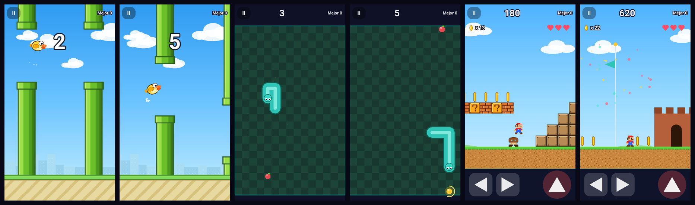

# Kivy Arcade

App móvil hecha con [Kivy](https://kivy.org) que funciona como una **sala de juegos**: un menú
principal y, dentro, tres juegos. Se empaqueta para **Android** (APK) e **iOS** con GitHub Actions
y se puede probar en el PC.

> ### 🎮 Esta es la rama `demo/completa`
> Contiene los **tres juegos terminados** (Flappy Bird, Snake y Mario 2D). Sirve para mostrar el
> resultado final y como solución de referencia del docente.
>
> La rama **`main`** tiene la misma app pero con los juegos como **esqueletos vacíos**: es el punto
> de partida de los alumnos. Ver [docs/DEMO.md](docs/DEMO.md).




## Los juegos

| Juego | Cómo se juega | Qué tiene |
|---|---|---|
| **Flappy Bird** | Toca la pantalla para aletear y pasa entre los tubos | Fondo con parallax (ciudad y nubes), pájaro animado que se inclina, dificultad progresiva, sacudida y partículas al chocar |
| **Snake** | Desliza el dedo para girar y come manzanas | Movimiento suave, ojos que miran hacia donde va, manzana dorada temporal con anillo de tiempo, velocidad creciente |
| **Mario 2D** | Botones ‹ › y salto en pantalla | Nivel de 124 azulejos con pozos, tuberías, escaleras, bloques sorpresa, 9 enemigos, 45 monedas, checkpoint, 3 vidas y bandera final |

Todos tienen **sonidos** generados por código, **vibración** en Android al chocar, pausa, récords
guardados y respetan los ajustes de sonido y vibración. En el PC también se juegan con el teclado
(flechas / WASD / espacio). **No usan archivos de imagen ni de audio**: todo se dibuja y se sintetiza
con código, lo que hace el empaquetado muy simple.

## Cómo está organizado

```
kivy-arcade/
├── main.py              ← arranca la app completa
├── run_game.py          ← arranca UN solo juego (para desarrollar)
├── arcade/              ← la app: menús, ajustes, puntuaciones y utilidades comunes
│   ├── game_base.py       GameScreen: bucle, pausa, fin de partida, récords, errores aislados
│   ├── gfx.py             degradados y partículas
│   ├── pixelart.py        sprites dibujados con letras -> texturas
│   └── sound.py           efectos de sonido sintetizados
├── games/
│   ├── _template/       ← plantilla mínima para crear un juego nuevo
│   ├── flappy/          ← Flappy Bird (game.py + art.py)
│   ├── snake/           ← Snake (game.py)
│   └── mario/           ← Mario 2D (game.py + level.py + sprites.py)
├── tests/               ← 50 pruebas automáticas (incluye bots que juegan los 3 juegos)
├── docs/                ← guías (demo, alumno, docente, pruebas y builds)
├── buildozer.spec       ← configuración del APK de Android
└── .github/workflows/   ← CI: pruebas, APK de Android, IPA de iOS
```

Las ideas clave:

- **Un juego = una carpeta.** La app descubre sola todo lo que haya en `games/`. Añadir un juego
  no obliga a editar ningún archivo compartido.
- **Un contrato común.** Cada juego hereda de `GameScreen` y rellena unos pocos «ganchos»
  (`build_game`, `new_game`, `update`). La clase base trae todo lo demás.
- **Un juego roto no rompe la app.** Si falla, el error se muestra en su propia pantalla.
- **Se prueba solo.** `python run_game.py snake` abre únicamente ese juego.

## Empezar (Windows)

> Kivy 2.3.1 **no funciona con Python 3.14**. Usa Python 3.13 (o 3.11 / 3.12). Si solo tienes la
> 3.14, instala la 3.13 al lado: `winget install Python.Python.3.13`.

```powershell
git clone <URL-del-repositorio>
cd kivy-arcade
git switch demo/completa            # los juegos terminados
py -3.13 -m venv .venv
.\.venv\Scripts\Activate.ps1
python -m pip install -r requirements-dev.txt
```

| Quiero... | Comando |
|---|---|
| Ver la app completa | `python main.py` |
| Probar un solo juego | `python run_game.py mario` |
| Ver cómo se vería en un iPhone 6 | `python main.py -m screen:phone_iphone_6,portrait,scale=.6` |
| Correr las pruebas | `python -m pytest` |
| Revisar el estilo del código | `python -m ruff check .` |

## Descargar el APK

En GitHub: pestaña **Actions** → **Build Android (APK)** → la última ejecución verde → **Artifacts**
→ `kivy-arcade-apk`. Instálalo en el teléfono (ver [docs/PRUEBAS_Y_BUILDS.md](docs/PRUEBAS_Y_BUILDS.md)).

## Documentación

| Para quién | Documento |
|---|---|
| Todos | [La demo: qué es y cómo se relaciona con `main`](docs/DEMO.md) |
| Alumnos | [Guía del alumno](docs/GUIA_ALUMNO.md): crear y probar tu juego, trabajo con git |
| Docente | [Guía del docente](docs/GUIA_DOCENTE.md): repositorio, colaboradores, ramas, revisión |
| Todos | [Pruebas y builds](docs/PRUEBAS_Y_BUILDS.md): probar en PC, Android e iOS, GitHub Actions |
| Cada juego | `games/<juego>/README.md`: cómo está hecho y retos para mejorarlo |

## Limitaciones conocidas

- La app es **solo vertical** por ahora.
- No se maneja el área segura del «notch» en iPhone (la barra superior podría quedar bajo la cámara).
- Los juegos se probaron a fondo en el PC (50 pruebas y bots que los juegan completos). Cómo se
  siente en cada teléfono (rendimiento, toque, sonido y vibración) conviene validarlo en un dispositivo real.
- iOS compila en CI pero no se ha ejecutado en un dispositivo (hace falta un Mac).
