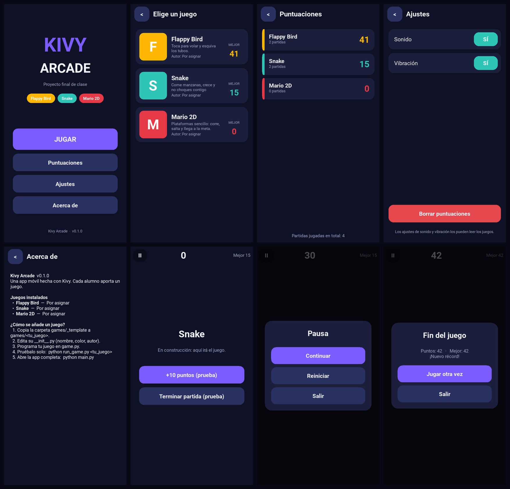

# Kivy Arcade

App móvil hecha con [Kivy](https://kivy.org) que funciona como una **sala de juegos**: un menú
principal y, dentro, un juego programado por cada alumno. Se empaqueta para **Android** (APK) e
**iOS** con GitHub Actions y se puede probar en el PC.



## Cómo está pensada: modular

```
kivy-arcade/
├── main.py              ← arranca la app completa
├── run_game.py          ← arranca UN solo juego (para desarrollar)
├── arcade/              ← la app (menús, ajustes, puntuaciones). La mantiene el docente.
├── games/
│   ├── _template/       ← plantilla: se copia para crear un juego nuevo
│   ├── flappy/          ← Alumno 1
│   ├── snake/           ← Alumno 2
│   └── mario/           ← Alumno 3
├── tests/               ← pruebas automáticas (corren en cada push)
├── docs/                ← guías (alumno, docente, pruebas y builds)
├── buildozer.spec       ← configuración del APK de Android
└── .github/workflows/   ← CI: pruebas, APK de Android, IPA de iOS
```

Las ideas clave:

- **Un juego = una carpeta.** La app descubre sola todo lo que haya en `games/`. Añadir un juego
  no obliga a editar ningún archivo compartido, así que **cada alumno trabaja en su carpeta y en su
  rama sin pisarse con los demás**.
- **Un contrato común.** Cada juego hereda de `GameScreen` y rellena unos pocos «ganchos»
  (`build_game`, `new_game`, `update`). La clase base ya trae el bucle de juego, la pausa, la
  pantalla de fin, la barra de puntuación y el guardado de récords.
- **Un juego roto no rompe la app.** Si un juego falla al cargarse o mientras se juega, se muestra
  el error en su propia pantalla y el resto sigue funcionando.
- **Se prueba solo.** `python run_game.py snake` abre únicamente ese juego.

## Empezar (Windows)

> Kivy 2.3.1 **no funciona con Python 3.14**. Usa Python 3.13 (o 3.11 / 3.12). Si solo tienes la
> 3.14, instala la 3.13 al lado: `winget install Python.Python.3.13`.

```powershell
git clone <URL-del-repositorio>
cd kivy-arcade
py -3.13 -m venv .venv
.\.venv\Scripts\Activate.ps1
python -m pip install -r requirements-dev.txt
```

| Quiero... | Comando |
|---|---|
| Ver la app completa | `python main.py` |
| Probar un solo juego | `python run_game.py snake` |
| Ver cómo se vería en un iPhone 6 | `python main.py -m screen:phone_iphone_6,portrait,scale=.6` |
| Correr las pruebas | `python -m pytest` |
| Revisar el estilo del código | `python -m ruff check .` |

## Documentación

| Para quién | Documento |
|---|---|
| Alumnos | [Guía del alumno](docs/GUIA_ALUMNO.md): crear y probar tu juego, trabajo con git |
| Docente | [Guía del docente](docs/GUIA_DOCENTE.md): repositorio, colaboradores, ramas, revisión |
| Todos | [Pruebas y builds](docs/PRUEBAS_Y_BUILDS.md): probar en PC, Android e iOS, GitHub Actions |
| Cada juego | `games/<juego>/README.md`: hitos sugeridos |

## Estado actual

Esto es una **demo**: el menú, las puntuaciones, los ajustes y el sistema de juegos funcionan.
Los tres juegos (`flappy`, `snake`, `mario`) son pantallas provisionales con botones de prueba;
la carpeta `games/_template` incluye un juego real mínimo («Toca el círculo») como modelo.

Limitaciones conocidas: la app es solo vertical por ahora, sin sonido todavía (los ajustes ya se
guardan para que los juegos los lean) y sin manejo del «notch» en iPhone.
